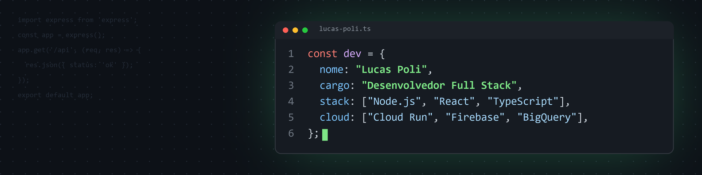

<h1 align="center">Olá, eu sou o Lucas Poli 👋</h1>

  <b>Desenvolvedor Full Stack</b> · Node.js · React · TypeScript · Google Cloud

  

## 💫 Sobre mim

- 💼 Desenvolvedor Full Stack na **S.E. Palmeiras**, em transição interna de Analista de Sistemas para desenvolvimento
- 🛠️ Construo aplicações web com **Node.js** e **React** (TypeScript) e publico no **Google Cloud** (Cloud Run, Firebase e BigQuery)
- 🎓 Tecnólogo em Análise e Desenvolvimento de Sistemas (UNINOVE) e em Redes de Computadores (UNIP)
- 🤖 Estudando IA Generativa: certificações Google e formação em Claude

## 💻 Tech Stack

**Front-end**

**Back-end e dados**

**Cloud**

**Ferramentas**

## 🚀 Projetos em destaque

| Projeto | Descrição | Stack |
|---|---|---|
| [Flappy Brasileirão ⚽](https://github.com/LucasPolidev/flappy-brasileirao) | Flappy Bird com os 20 times da Série A, com recordes por time e executável para Windows | Python · pygame |
| [Projeto-Javascript](https://github.com/LucasPolidev/Projeto-Javascript) | Calculadora de IMC | JavaScript · HTML · CSS |
